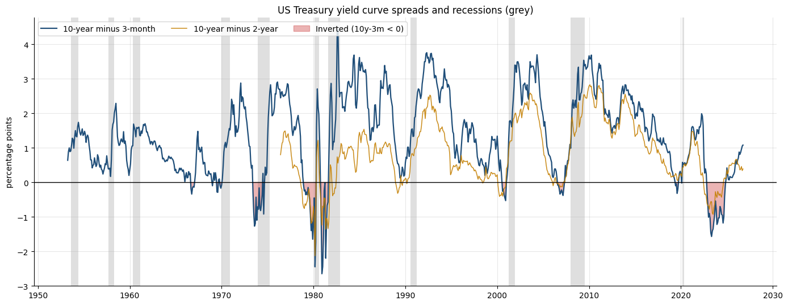
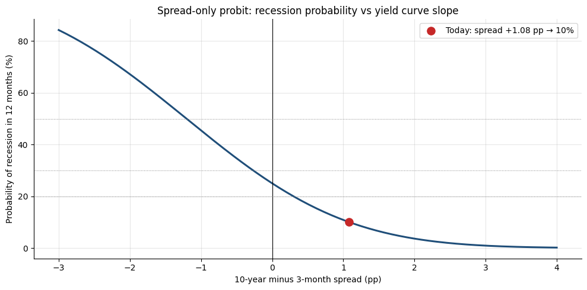
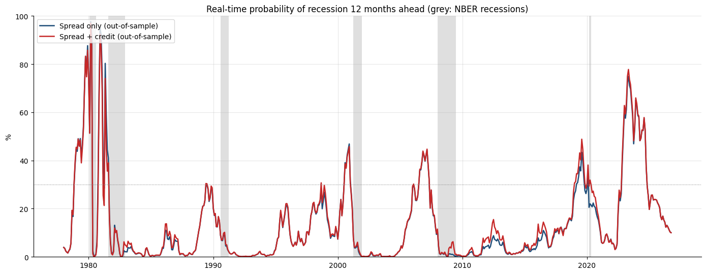
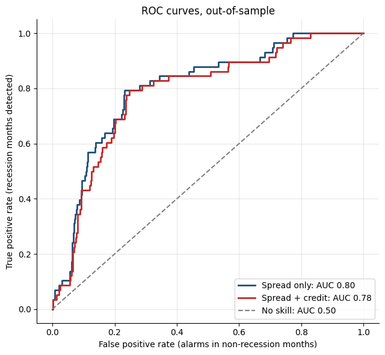
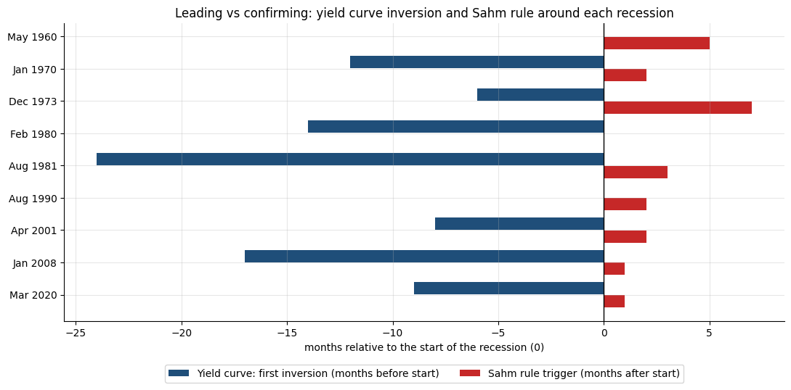
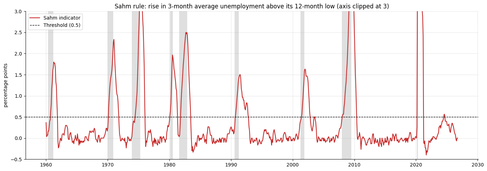

# Yield Curve Recession Model: Can the Bond Market Predict US Recessions?

**Author:** Mattia Mariani

## Summary

This project estimates the probability of a US recession twelve months ahead from the slope of the Treasury yield curve, tests whether the signal works in real time, studies every inversion since 1959, and compares the curve with a labour-market signal, the Sahm rule.

**Key findings:**

1. **The yield curve is a strong but imperfect recession predictor.** The 10-year minus 3-month spread inverted before **7 of the 9** recessions since 1960, with a median lead of **12 months** (range 6-24).
2. **The signal survives a real-time test.** A probit model re-estimated every month since 1978 using only information available at the time reaches an out-of-sample **AUC of 0.80**, almost the same as in-sample (0.82). The real-time probability averaged 31% ahead of recession months against 12% otherwise.
3. **The 2022-2024 inversion was a false alarm.** It was the longest (25 months) and one of the deepest (−1.57 pp) in the sample, pushing the real-time probability above 70% in 2023, yet no recession followed. The only other false alarm since 1959 was in 1966-67.
4. **Credit spreads add nothing.** Adding the BAA corporate spread leaves the fit unchanged (coefficient 0.01, s.e. 0.24) and slightly worsens the out-of-sample performance.
5. **The Sahm rule confirms recessions quickly and reliably.** It triggered a median of **2 months** after each recession began, with two false signals (2003 and 2024).
6. **Today, recession risk is low.** In October 2026 the curve is positively sloped (+1.08 pp), the model's probability of a recession within 12 months is **10%**, down from 20% a year earlier, and the Sahm indicator is at 0.00.

## Research question

How well does the slope of the US Treasury yield curve predict recessions twelve months ahead? Does the signal survive a real-time test, how often does it give false alarms, and how does it compare with a labour-market indicator?

## Why the yield curve predicts recessions

Normally long-term interest rates are higher than short-term ones, because investors want compensation for lending for longer. When the curve **inverts**, short rates are above long rates. Two mechanisms link this to recessions:

- **Expectations:** long-term yields reflect the expected path of short-term rates. An inversion means markets expect the central bank to *cut* rates in the future, which usually happens in a downturn.
- **Monetary policy and credit:** an inversion usually means the central bank has raised short rates to a restrictive level. Banks borrow short and lend long, so a flat or inverted curve squeezes their margins and their willingness to lend.

## Data

All series are monthly, from FRED (Federal Reserve Bank of St. Louis):

| Series | FRED code | Role |
|---|---|---|
| 10-year Treasury yield | GS10 | Long end of the curve |
| 3-month Treasury bill | TB3MS | Short end of the curve |
| 2-year Treasury yield | GS2 | Alternative short end (from 1976) |
| Moody's BAA corporate yield | BAA | Credit spread (BAA minus 10-year) |
| Unemployment rate | UNRATE | Sahm rule |
| NBER recession indicator | USREC | Official recession dates |

The main indicator is the **10-year minus 3-month** spread, used by the New York Fed: research by Estrella and Mishkin found it to be the most reliable predictor. The 10-year minus 2-year spread, more common in the financial press, is shown for comparison.

## Methodology

**1. Probit model.** The target is binary: is the US in recession 12 months from now (1) or not (0)? A linear regression could produce "probabilities" below 0 or above 1. A probit model maps the explanatory variables into a probability through the standard normal distribution, so the result is always between 0 and 1:

$$P(\text{recession}_{t+12} = 1) = \Phi(\alpha + \beta\, \text{spread}_t)$$

This is the model of Estrella and Mishkin (1998) and of the New York Fed. A second version adds the BAA credit spread. Standard errors are HAC-robust, because overlapping 12-month horizons make errors strongly autocorrelated. Sample: 1959-2025.

**2. Out-of-sample test.** From 1978, every month the model is re-estimated using only outcomes known at the time (since the target is 12 months ahead, at month $t$ it can only learn from predictors up to $t-12$), then forecasts the probability of recession 12 months later. Performance is measured by the **AUC** (area under the ROC curve): 0.5 means no predictive power, 1 means perfect separation of recession and non-recession months.

**3. Event analysis.** For each recession: the lead time of the first inversion, the highest real-time probability in the year before, and the timing of the Sahm rule. For each inversion: whether a recession followed within 24 months.

**4. Sahm rule.** The 3-month average unemployment rate rising at least 0.5 pp above its lowest 3-month average of the previous 12 months, a signal that a recession has started.

## Results

### 1. Probit model

| Model | Months | Spread coef. (s.e.) | Credit spread coef. (s.e.) | Pseudo-R² | AUC (in-sample) |
|---|---|---|---|---|---|
| Spread only | 802 | **−0.56** (0.12) | | 0.19 | 0.82 |
| Spread + credit | 802 | −0.56 (0.13) | 0.01 (0.24) | 0.19 | 0.82 |

The spread coefficient is negative and highly significant: **the flatter the curve, the higher the probability of recession**. The model translates the spread into probabilities as follows:

| 10y-3m spread | Probability of recession in 12 months |
|---|---|
| +0.30 pp | 20% |
| −0.27 pp | 30% |
| −1.20 pp | 50% |

The pseudo-R² of 0.19 is typical for this kind of model: the curve does not tell exactly *when* a recession will start, but it shifts the odds substantially.

**Credit spreads add nothing.** Once the yield curve is in the model, the BAA spread has no additional predictive power. The BAA-Treasury spread moves slowly and also reflects liquidity and the business cycle itself. More refined measures of credit stress, such as the excess bond premium of Gilchrist and Zakrajšek (2012), have been found to add information and are a natural extension.

### 2. Real-time performance

| Model | Months | AUC out-of-sample | AUC in-sample, same months | Avg probability before recessions | Avg probability otherwise |
|---|---|---|---|---|---|
| Spread only | 574 | **0.80** | 0.82 | 31% | 12% |
| Spread + credit | 574 | 0.78 | 0.82 | 30% | 12% |

The out-of-sample AUC is almost as high as the in-sample one: **the signal was genuinely available in real time**, not only with hindsight. In practice, the real-time probability rose above 40% before the recessions of 1980, 1981, 2001, 2008 and 2020. It also rose to over 70% in 2023, without a recession following.

### 3. Recession by recession

| Recession start | First inversion (24 months before) | Lead (months) | Max real-time probability in the prior year | Sahm rule triggered | Sahm lag (months) |
|---|---|---|---|---|---|
| May 1960 | no inversion | | *(before test period)* | Oct 1960 | 5 |
| Jan 1970 | Jan 1969 | 12 | *(before test period)* | Mar 1970 | 2 |
| Dec 1973 | Jun 1973 | 6 | *(before test period)* | Jul 1974 | 7 |
| Feb 1980 | Dec 1978 | 14 | 88% | Feb 1980 | 0 |
| Aug 1981 | Aug 1979 | 24 | 95% | Nov 1981 | 3 |
| Aug 1990 | no inversion | | 29% | Oct 1990 | 2 |
| Apr 2001 | Aug 2000 | 8 | 47% | Jun 2001 | 2 |
| Jan 2008 | Aug 2006 | 17 | 44% | Feb 2008 | 1 |
| Mar 2020 | Jun 2019 | 9 | 43% | Apr 2020 | 1 |

- **The lead time is long and variable**, from 6 to 24 months. The curve says a recession is likely, but not *when* it will start.
- **Two recessions were not preceded by an inversion.** In **1990** the curve flattened to close to zero in 1989 without inverting in monthly data, and the model's probability peaked at only 29%. The New York Fed's version, which converts bill yields to a bond-equivalent basis, shows a slight inversion. In **1960** the curve also stayed positive.
- **The 2020 recession was caused by the pandemic**, a shock no financial indicator could predict. The 2019 inversion "called" it by coincidence, or at most signalled an economy that was already slowing.

### 4. Inversion episodes and false alarms

| Inversion episode | Inverted months | Deepest inversion | Outcome |
|---|---|---|---|
| Sep 1966 - Jan 1967 | 5 | −0.34 pp | **no recession (false alarm)** |
| Jul 1969 - Jan 1970 | 5 | −0.29 pp | recession, Jan 1970 |
| Jun 1973 - Sep 1974 | 15 | −1.27 pp | recession, Dec 1973 |
| Dec 1978 - Apr 1980 | 17 | −2.45 pp | recession, Feb 1980 |
| Nov 1980 - Aug 1981 | 10 | −2.65 pp | recession, Aug 1981 |
| Aug 2000 - Dec 2000 | 5 | −0.53 pp | recession, Apr 2001 |
| Aug 2006 - Apr 2007 | 9 | −0.38 pp | recession, Jan 2008 |
| Jun 2019 - Sep 2019 | 4 | −0.32 pp | recession, Mar 2020 |
| Nov 2022 - Nov 2024 | **25** | **−1.57 pp** | **no recession (false alarm)** |

Out of 9 inversion episodes since 1959, **7 were followed by a recession** within 24 months. In 1966-67 the US experienced a sharp slowdown and a credit crunch, but not a recession.

**Why did the 2022-2024 inversion not lead to a recession?** This is the most important open question for the model. Several explanations have been proposed, and they are not mutually exclusive:
- **The cause of the inversion was different.** The Fed raised rates very quickly from near zero to fight inflation, and markets expected cuts as inflation came down, not because of a recession. The curve was pricing *disinflation*, not a downturn.
- **Monetary policy transmitted more slowly.** Households had locked in low fixed-rate mortgages and firms had extended the maturity of their debt in 2020-2021, so higher short rates took longer to bite.
- **Strong offsetting forces**, including large fiscal deficits, savings accumulated during the pandemic and, from 2023, a surge in labour supply and investment.
- **A lower term premium** after years of quantitative easing may have made inversions easier to occur without signalling a downturn.

The lesson for a strategist: the yield curve remains informative, but **the reason behind an inversion matters**, and a signal calibrated on the past can fail when the economic regime changes.

### 5. The Sahm rule

The Sahm rule triggered in or after **every** recession since 1960, typically **0-3 months after it began** (median 2 months, maximum 7 in 1974). It is a **confirming** indicator: it does not forecast, but it identifies a recession far earlier than the official NBER announcement, which usually comes 6-18 months after the start.

It produced two signals without a recession:
- **July 2003**, during the "jobless recovery" after the 2001 recession, when unemployment kept rising even though the economy was growing. With today's revised data the indicator just touches 0.5, so it is a borderline case.
- **July 2024**, when it reached about 0.57. Claudia Sahm herself argued that this rise in unemployment reflected mainly a **surge in labour supply** (immigration and re-entry into the labour force) rather than layoffs, which the rule cannot distinguish.

Combined with the 2022-2024 inversion, this gives an interesting result: **in 2023-2024 both the leading and the confirming indicator flashed red, and neither was followed by a recession.** It is the clearest recent example of how unusual the post-pandemic cycle has been.

### 6. Today's reading (October 2026)

| Indicator | Value |
|---|---|
| 10y-3m spread | +1.08 pp |
| 10y-2y spread | +0.39 pp |
| BAA credit spread | 1.46 pp |
| Probability of recession within 12 months, spread only | **10%** |
| Probability of recession within 12 months, spread + credit | 10% |
| Sahm indicator | 0.00 pp (not triggered) |

The curve has been positively sloped since late 2024, and the model's probability has fallen steadily, from 20% in November 2025 to 10% in October 2026, close to its long-run average outside recessions. The labour market shows no sign of stress: unemployment is stable at about 4.1-4.2%.

One feature is worth watching. The recent steepening is driven by **rising long-term yields** (the 10-year rose from 4.5% in June to 5.1% in October 2026, faster than the 3-month bill), a pattern known as a *bear steepening*. This is different from the *bull steepening* that often precedes recessions, when short rates fall quickly because the central bank is cutting in response to a weakening economy. A steeper curve driven by higher long rates, which can reflect a rising term premium, inflation risk or fiscal concerns, lowers the model's probability but is not necessarily good news for growth.

## Conclusions

1. **The yield curve remains the single most informative recession predictor**, with a real-time AUC of 0.80 and a typical lead of about a year.
2. **It tells you *whether*, not *when***: lead times range from 6 to 24 months.
3. **Its record is no longer perfect.** The 2022-2024 inversion, the longest in the sample, was not followed by a recession, most likely because it reflected disinflation expectations rather than recession expectations.
4. **The best practice is to combine signals**: the curve to raise the alarm, the Sahm rule to confirm it, and an understanding of *why* the curve is moving to judge the signal.
5. **Today both indicators point to low recession risk** (10% probability, no Sahm signal).

## Limitations

- **Few events.** Only nine recessions since 1960, so every estimate rests on a handful of episodes.
- **NBER dates are announced with a lag** of 6-18 months, so a real-time forecaster would have known recession outcomes later than assumed in the out-of-sample test. Recent months could also belong to a recession not yet dated.
- **Structural change.** Quantitative easing, a lower term premium and changes in the transmission of monetary policy may have made inversions less informative.
- **Bill yields** are on a discount basis, while the New York Fed converts them to a bond-equivalent basis; this matters for borderline cases such as 1989.

## Possible extensions

- **Near-term forward spread** (Engstrom and Sharpe, 2019), which focuses on expected policy rates over the next 18 months
- **Excess bond premium** (Gilchrist and Zakrajšek, 2012) as a better measure of credit stress
- **Term-premium adjustment**, separating expected rates from the term premium (e.g. ACM estimates)
- **Euro-area version** using Bund yields and CEPR recession dates
- **A combined model** using the curve, credit conditions and the Sahm rule together

## How to run

**Google Colab (recommended):

## References

- Engstrom, E. C. and Sharpe, S. A. (2019). The near-term forward yield spread as a leading indicator. *Financial Analysts Journal*, 75(4), 37-49.
- Estrella, A. and Hardouvelis, G. A. (1991). The term structure as a predictor of real economic activity. *Journal of Finance*, 46(2), 555-576.
- Estrella, A. and Mishkin, F. S. (1998). Predicting U.S. recessions: financial variables as leading indicators. *Review of Economics and Statistics*, 80(1), 45-61.
- Gilchrist, S. and Zakrajšek, E. (2012). Credit spreads and business cycle fluctuations. *American Economic Review*, 102(4), 1692-1720.
- Sahm, C. (2019). Direct stimulus payments to individuals. In *Recession Ready: Fiscal Policies to Stabilize the American Economy*, Brookings Institution / Hamilton Project.

